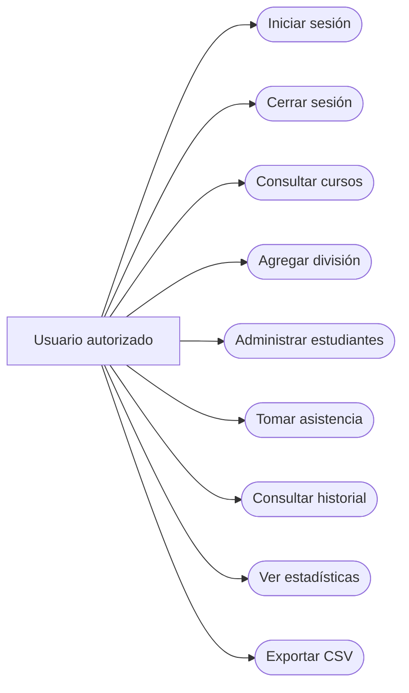
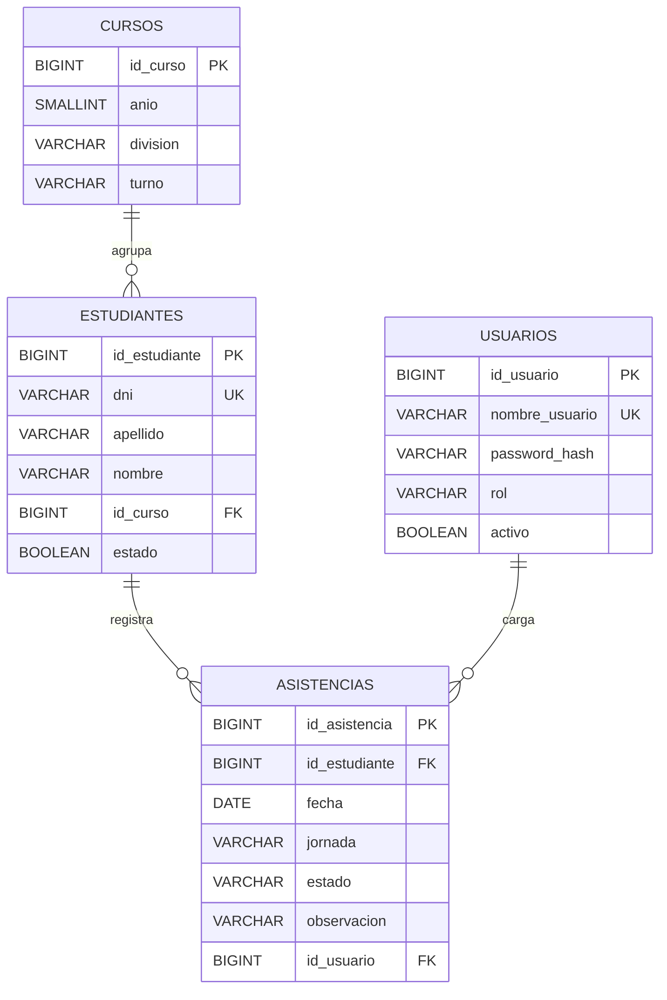

# Diagramas del sistema

## Casos de uso

El actor es el usuario autorizado. Todas las funciones de gestión requieren iniciar sesión.

## Entidad-relación

## Restricciones

- `estudiantes.dni` es único.
- `cursos(anio, division, turno)` es una combinación única.
- `asistencias(id_estudiante, fecha, jornada)` es una combinación única.
- `asistencias.estado` admite P, A, T o AJ.
- Una baja cambia `estado` a falso, sin borrar asistencias anteriores.

El esquema físico se encuentra en [database/schema.sql](../database/schema.sql).
